## Practica 3  
# Ejercicio 1 

**Parte 1**: Conversion de Automatas a Expresiones Regulares con JFLAP.  

1.1 Conversion de Automatas Finitos Deterministas a Expresiones Regulares. Utilizando la herramienta JFLAP, el alumno debera realizar las siguientes actividades:  

   1. Seleccion y analisis de automatas.
     * Seleccionar 5 automatas deterministas de la lista de ejercicios anteriores.
     * Realizar un analisis previo a la conversion, identificando patrones que podrian simplificar la expresion regular resultante.  

**Diseño:**  
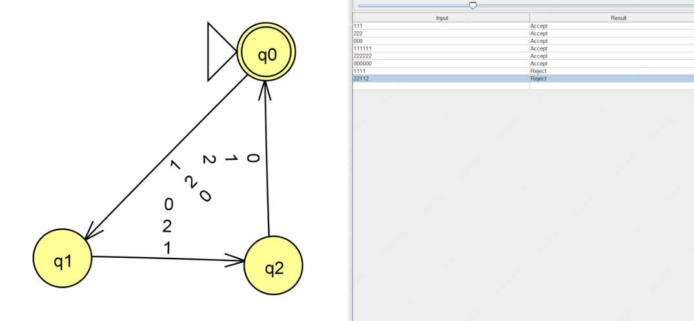

**Justificacion:**  
En total, hay tres estados y tres transiciones por cada simbolo del alfabeto porque siempre pasamos de un estado al siguiente de manera ordenada. Así, el autómata verifica que la longitud de la cadena sea un múltiplo de 3 sin necesidad de contar directamente, sino solo cambiando de estado.  

**Simplificacion:**  
El patron que podemos notar es que en cada función de transición repiten las mismas letras del alfabeto, por lo que podríamos reducirlo a 2 estados.  
  

**Diseño:**  
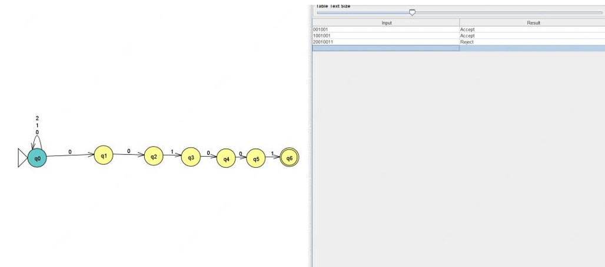  

**Justificacion:**  
Este AFD necesita 7 estados y múltiples transiciones para asegurarse de que las palabras terminan en "001001". Cada estado representa un paso en la identificación de esta secuencia. Si se interrumpe la secuencia, el autómata ajusta su posición para intentar seguir reconociéndola sin perder información innecesaria.  

**Simplificacion:**  
En cada estado vemos una sucesión de letras que van en un orden especifico, podríamos crear una función de transición en donde aceptara de entrada las letras del alfabeto que deberán de ser aceptadas y mandar a un estado vacio las que no.  

  
**Diseño:**  
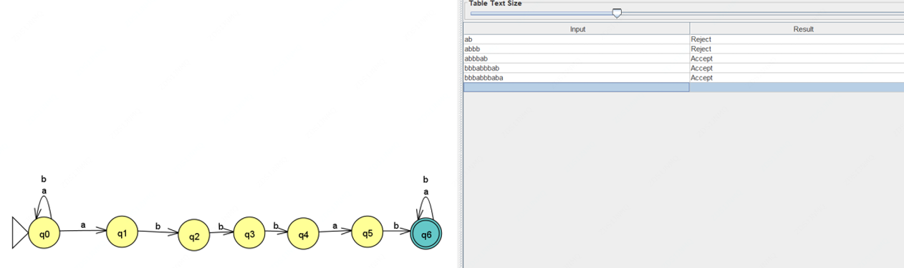  

**Justificacion:**  
Se necesitan 7 estados y varias transiciones para asegurarse de que el autómata pueda reconocer la secuencia "abbbab" dentro de cualquier palabra. Cada estado representa un avance en la detección de la secuencia, permitiendo que el autómata no pierda el progreso si aparece un patrón parcial. Con este diseño, cualquier palabra que contenga "abbbab" será aceptada.  

**Simplificacion:**  
Vemos en 7 estados, una función de transicion de letras que van en un orden especifico, podríamos crear una función de transición en donde aceptara de entrada las letras del alfabeto.  

  
**Diseño:**  
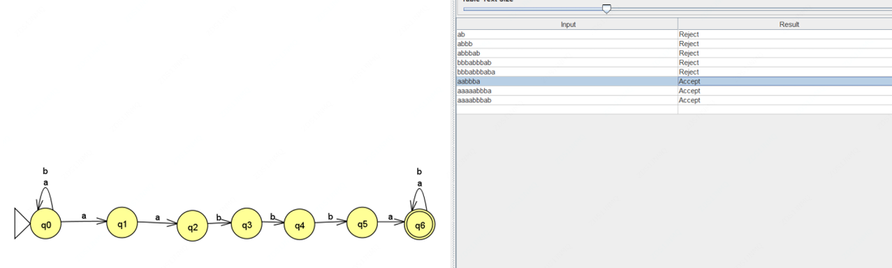  

**Justificacion:**  
Se necesitan 7 estados y varias transiciones para asegurarse de que el autómata pueda reconocer la secuencia "aabbba" dentro de cualquier palabra. Cada estado representa un avance en la detección de la secuencia, permitiendo que el autómata no pierda el progreso si aparece un patrón parcial. Con este diseño, cualquier palabra que contenga " aabbba " será aceptada aunque tenga letras antes o después de la cadena.  

**Simplificacion:**  
Vemos en 7 estados, una función de transicion de letras que van en un orden especifico, podríamos crear una función de transición en donde aceptara de entrada las letras del alfabeto.  

  

**Diseño:**  
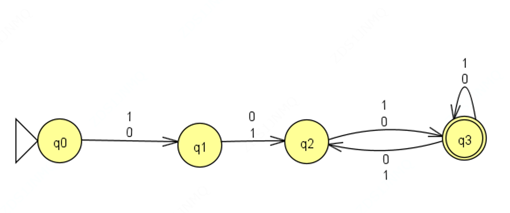  

**Justificacion:**  
Este AFD necesita 4 estados en donde podrá ser aceptada cualquier entrada donde tenga por lo menos una cadena de longitud 3.  

**Simplificacion:**  
Podemos simplificarla a un automata M donde solo sean 2 estados con funciones de transición.  

  
   2. Proceso de Conversion.
       * Para cada automata seleccionado:
         * Realizar la conversion a expresion regular utilizando el metodo de eliminacion de estados en JFLAP.
         * Documentar paso a paso el proceso de conversion.
         * Capturar la expresion resultante.  

A.   
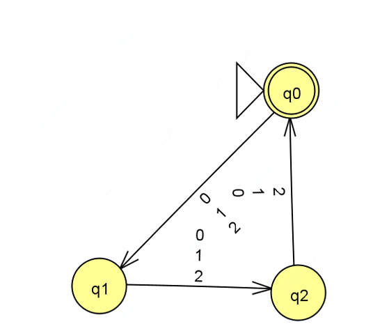  

* Lo primero que nos pide es crear un nuevo estado final para este ser asignado como único. Aquí lo que notamos es que si no lo creamos, no dejara avanzar.  
* Posterior a esto va a crear una nueva función de transición pero con transiciones lambda.  

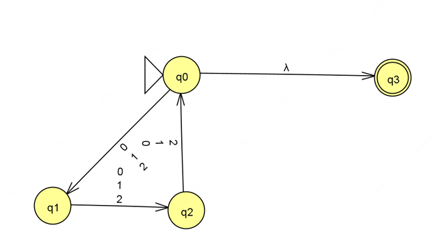  

* Comenzara a agrupar y colapsar el automata 3 veces.  

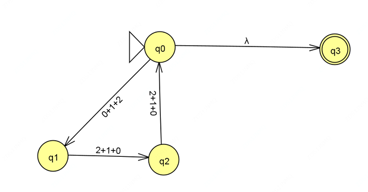  

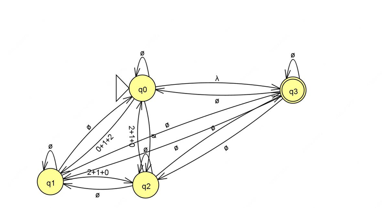  

* Al final agrupa todas las transiciones en una expresión regular y solo 2 estados.  

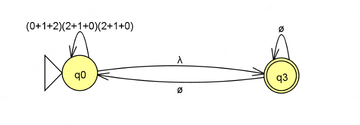  

* Comienza transformando la función con letras que se llamen a si mismo en una expresión regular.  

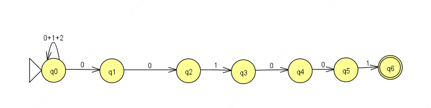  

* Posterior, pedirá 42 transformaciones en las cuales se verán afectadas los estados de q1 a q6.  

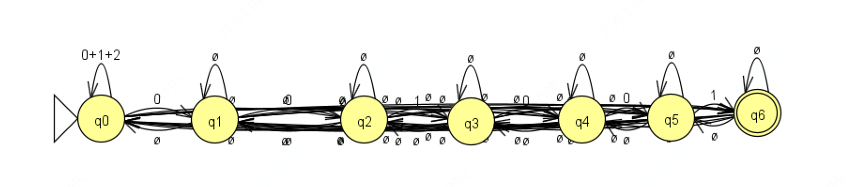  

* Al final creara una expresión regular con el valor de la cadena a aceptar en 2 estados.  

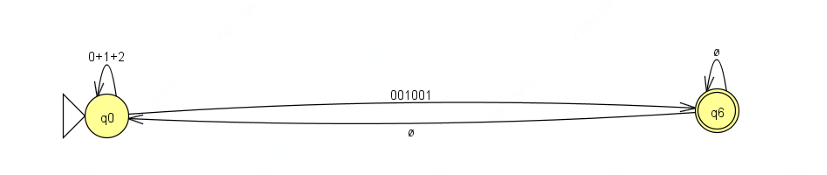  

* Comienza transformando la función con letras que se llamen a si mismo en una expresión regular.  

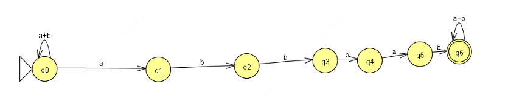  

* Posterior, pedirá 42 transformaciones lambda, en las cuales se verán afectadas los estados de q1 a q6.  

  

* Al final creara una expresión regular con el valor de la cadena a aceptar en 2 estados.  

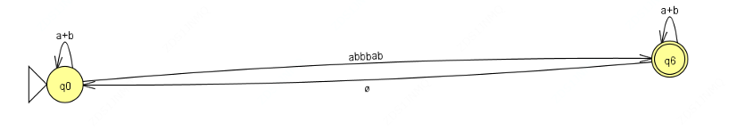  

* Comienza transformando la función con letras que se llamen a si mismo en una expresión regular.  

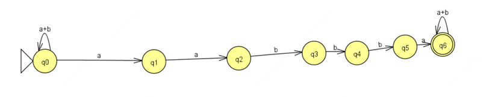  

* Posterior, pedirá 42 transformaciones lambda, en las cuales se verán afectadas los estados de q1 a q6.  

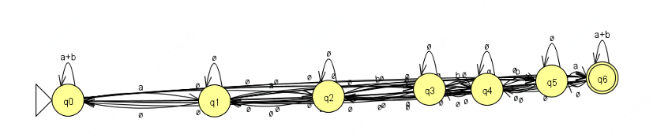  

* Al final creara una expresión regular con el valor de la cadena a aceptar en 2 estados.  

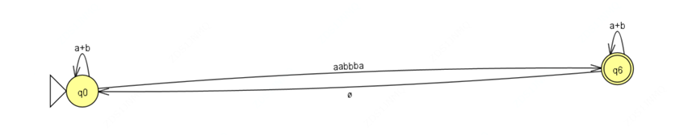  

* Convierte a expresiones regulares las funciones de transicion.  

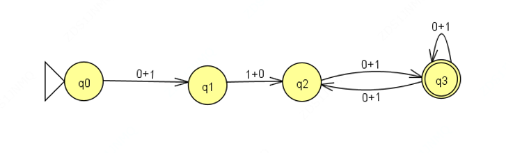  

* Reforma las transiciones agregando funciones vacías.  

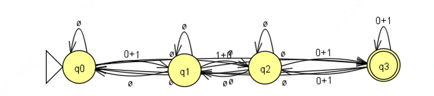  

* Remueve loes estados que no son finales ni iniciales.  

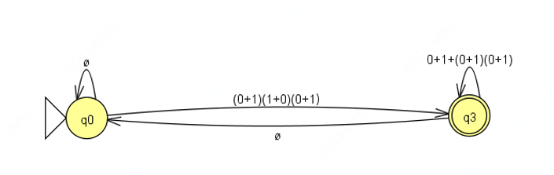  

3. Comprobacion y mejora.
   * Parta cada expresion regular obtenida:  
     * Verificar su equivalencia con el autómata original probando al menos 5 cadenas en ambos formalismos.
     * Identificar posibles simplificaciones en la expresión regular.
     * Proponer una versión optimizada de la expresión regular cuando sea posible.  

   1.  
   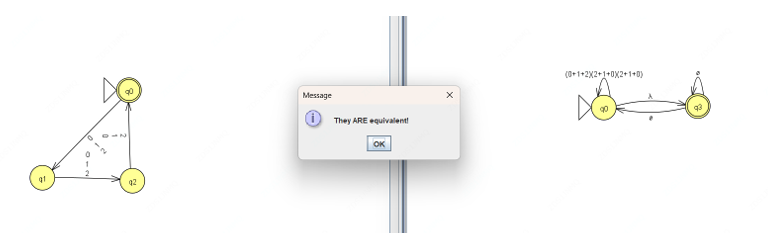  

   2.  
   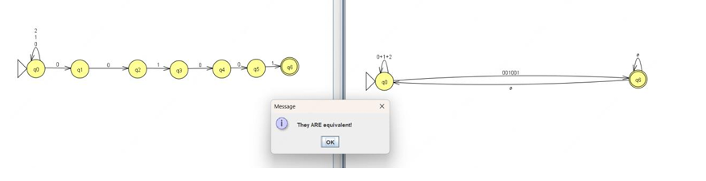  

   3.  
   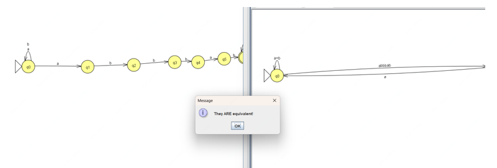  

   4.  
   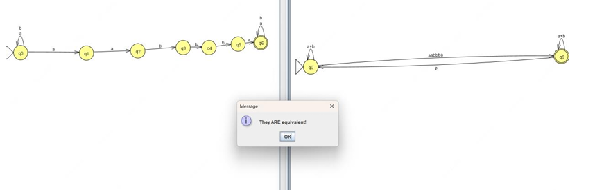  

   5.  
   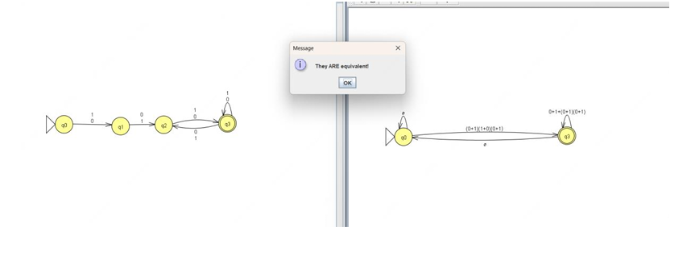  

1. **Método de Eliminación de Estados**.  
Este método consiste en eliminar progresivamente los estados del autómata finito mientras se reescriben las transiciones en forma de expresiones regulares.  

Pasos:  
* Se identifican los estados de inicio y aceptación.  
* Se eliminan estados intermedios, reescribiendo las transiciones con expresiones regulares equivalentes.  
* Al final, la única transición restante entre el estado inicial y el de aceptación representa la expresión regular del autómata

2. **Método de Ecuaciones**.  

Este método usa ecuaciones algebraicas con expresiones regulares para 
representar las transiciones del autómata:  

Pasos:  
* Se define una ecuación para cada estado, donde el lado derecho expresa las transiciones en términos de expresiones regulares.
* Se resuelven las ecuaciones mediante sustitución hasta obtener una expresión regular para el estado inicial.  

3. **Método de Arden**.  
**Lema de Arden:**  
 X=AX+B  
 donde:  
* X es una expresión desconocida. 
* A y B son expresiones regulares.  

El lema establece que la solución general para esta ecuación es:  

X=A∗B  

Este método se basa en el Lema de Arden, que establece que una ecuación de la forma:  

X=AX+B  

Tiene la solución:  

X=A∗B  

Se usa este principio para resolver sistemas de ecuaciones obtenidos del autómata, simplificando gradualmente las expresiones hasta obtener una única expresión regular.  

**Conluciones:**  
El diseño de AFD ayuda a estructurar estados y transiciones para detectar patrones en palabras de manera eficiente. Se optimiza la detección de subcadenas evitando reinicios innecesarios y ajustando la cantidad de estados según la complejidad del patrón. Además, la simplificación de AFD permite reducir la cantidad de estados sin afectar su funcionamiento, haciendo más eficiente su representación y procesamiento. También pueden verse como representaciones visuales de condiciones lógicas, donde cada estado actúa como una decisión que guía el flujo de lectura, asegurando la aceptación solo de palabras válidas.  

**Bibliografias:**  
Qué es un Autómata Finito Determinista (AFD)?.  

* https://www.youtube.com/watch?v=d9aEE-uLmNE 
* http://www.solsona.com.uy/notas/lenguajes-formales/automatas/lemaarden#:~:text=En%20palabras%2C%20A%E2%8B%86%E2%8B%85,entonces%20dicha%20soluci%C3%B3n%20es%20%C3%BAnica. 
* https://libroweb.alfaomega.com.mx/book/685/free/ovas_statics/cap9/Lenguajes%20Regulares.%20Garcia%20Osorio,%20Cesar%20Ignacio.pdf 