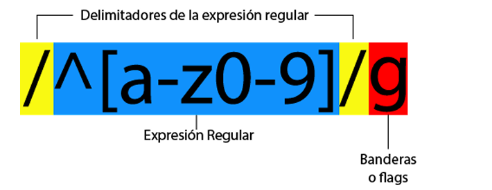
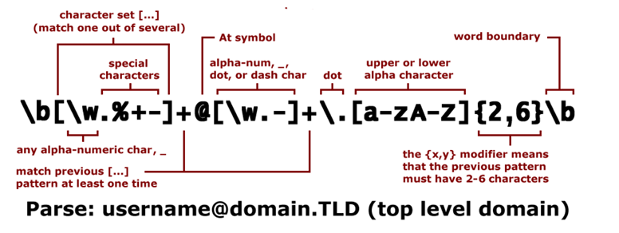

# Practica 4. Uso de las expresiones Regulares y Extension de Software para Convertir Expresiones Regulares  

1. **Ejercicio 1**: Investigación sobre Expresiones Regulares.  

   * **Objetivo**: Realizar una investigación exhaustiva sobre las expresiones regulares, su importancia teórica y sus aplicaciones prácticas.  

   * **Investigación sobre Expresiones Regulares**: Teoría y Aplicaciones.
   * **Definición formal de lenguaje regular**.  

   Un lenguaje regular es un conjunto de cadenas que puede ser reconocido por un autómata finito. Formalmente, un lenguaje L es regular si y solo si existe un autómata finito determinista (AFD) o no determinista (AFND) que lo acepta.  
   En términos de la teoría de lenguajes formales, un lenguaje L sobre un alfabeto Σ es regular si cumple alguna de estas condiciones equivalentes:

   * L puede ser reconocido por un autómata finito.
   * L puede ser generado por una gramática regular.  
   * L puede ser descrito mediante una expresión regular.  

   * **Definición formal y componentes básicos de las expresiones regulares**  

   Una expresión regular es una notación algebraica que permite especificar un patrón de cadenas sin enumerar todos sus elementos. Formalmente, se define de manera recursiva:  

      * ∅ es una expresión regular que denota el conjunto vacío.
      * ε es una expresión regular que denota el conjunto que contiene solo la cadena vacía.
      * Para cada símbolo a en el alfabeto Σ, a es una expresión regular que denota el conjunto {a}.  
      * Si r y s son expresiones regulares, entonces:  

         * (r|s) es una expresión regular que denota la unión de los lenguajes denotados por r y s.  
         * (rs) es una expresión regular que denota la concatenación de los lenguajes denotados por r y s.  
         * (r*) es una expresión regular que denota el cierre de Kleene del lenguaje denotado por r.  

           

    Los componentes básicos de las expresiones regulares son:  

    * **Literales**: Símbolos que se representan a sí mismos (a, b, 1, etc.).
    * **Metacaracteres**: Símbolos con significados especiales (*, +, ?, |, etc.).  
    * **Clases de caracteres**: Conjuntos de caracteres representados entre corchetes [abc].  
    * **Cuantificadores**: Indicadores de repetición (*, +, ?, {n}, {n,m}).  
    * **Anclajes**: Posiciones específicas en la cadena (^, $).  
    * **Grupos**: Subexpresiones entre paréntesis que se tratan como una unidad.  

    **Operaciones fundamentales en expresiones regulares**  

    Las tres operaciones fundamentales en expresiones regulares son:  

    * **Concatenación (rs)**: Si r y s son expresiones regulares que representan los lenguajes L(r) y L(s) respectivamente, entonces rs representa el lenguaje. L(rs) = {αβ | α ∈ L(r) y β ∈ L(s)}, es decir, todas las cadenas formadas al concatenar una cadena de L(r) seguida de una cadena de L(s).  
    * **Unión (r|s)**: Si r y s son expresiones regulares que representan los lenguajes L(r) y L(s), entonces r|s representa el lenguaje L(r|s) = L(r) ∪ L(s), es decir, el conjunto de todas las cadenas que están en L(r) o en L(s). 
    * **Cierre de Kleene (r)**: Si r es una expresión regular que representa el lenguaje L(r), entonces r representa el lenguaje L(r*) = {ε} ∪ L(r) ∪ L(r)² ∪ L(r)³ ∪ ..., es decir, la unión de todas las concatenaciones de cero o más cadenas de L(r).  

    **Jerarquía de Chomsky y ubicación de los lenguajes regulares**  

    La jerarquía de Chomsky clasifica los lenguajes formales y sus gramáticas correspondientes en cuatro tipos:  

    * **Tipo 0 (Lenguajes recursivamente enumerables)**:  

        * Reconocidos por Máquinas de Turing.  
        * Sin restricciones en las reglas de producción.  

    * **Tipo 1 (Lenguajes sensibles al contexto)**:  

        * Reconocidos por Autómatas linealmente acotados.  
        * Reglas de la forma: αAβ → αγβ, donde A es un no terminal y α, β, γ son cadenas con γ ≠ ε.  

    * **Tipo 2 (Lenguajes libres de contexto)**:  

        * Reconocidos por Autómatas de pila.  
        * Reglas de la forma: A → γ, donde A es un no terminal y γ es una cadena.  

    * **Tipo 3 (Lenguajes regulares)**:  

        * Reconocidos por Autómatas finitos.
        * **Reglas de la forma**: A → aB o A → a, donde A y B son no terminales y a es un terminal.  

    Los lenguajes regulares constituyen la clase más restringida en la jerarquía de Chomsky, siendo un subconjunto propio de cada uno de los otros tipos. Algunas propiedades importantes:  

    * Todo lenguaje regular es libre de contexto, pero no viceversa.
    * Los lenguajes regulares son cerrados bajo operaciones como unión, concatenación, complemento, intersección y diferencia.
    * Existen lenguajes simples como {a^n b^n | n ≥ 0} que no son regulares, lo que se puede demostrar mediante el Lema de Bombeo.  
    
    Esta clasificación es fundamental en la teoría de la computación, ya que establece una clara distinción entre los distintos tipos de lenguajes formales según su complejidad computacional y la potencia requerida para reconocerlos.  
    
    **Equivalencia entre Expresiones Regulares y Autómatas Finitos: Teorema de Kleene**  

    El Teorema de Kleene, formulado por Stephen Cole Kleene en 1956, establece una equivalencia fundamental en la teoría de lenguajes formales:  

    Un lenguaje es regular si y solo si puede ser descrito mediante una expresión regular.  

    Esta equivalencia conecta tres conceptos fundamentales:  

    * Expresiones regulares.  
    * Automatas finitos.
    * Lenguajes regulares.

    El teorema se demuestra en dos direcciones:  

2. **Ejercicio 2**: De expresiones regular a automata.  

Para cada expresión regular, existe un autómata finito no determinista (AFND) que reconoce exactamente el mismo lenguaje. La construcción se realiza inductivamente:  

* Para expresiones regulares básicas (∅, ε, y símbolos individuales), se construyen autómatas sencillos.  
* Para expresiones compuestas mediante operadores (unión, concatenación, cierre de Kleene), se combinan los autómatas correspondientes mediante construcciones específicas.  

3. **Ejercicio 3**: De automatas a expresiones regulares.  

Para cada autómata finito, existe una expresión regular que describe exactamente el mismo lenguaje. Esto puede demostrarse mediante:  }

* El método de eliminación de estados (algoritmo de McNaughton-Yamada).  
* El método de las ecuaciones de estado (algoritmo de Arden).  

Este teorema es fundamental porque establece la equivalencia expresiva entre dos formalismos aparentemente distintos, demostrando que ambos describen exactamente la misma clase de lenguajes (los lenguajes regulares).  

4. **Ejercicio 4**: Aplicaciones: validadores.  

* Validacion de datos de entrada:  

   * **Correos electrónicos**: ^[a-zA-Z0-9._%+-]+@[a-zA-Z0-9.-]+\.[a-zA-Z]{2,}$.  
   * **Números telefónicos**: ^\+?[0-9]{1,3}[-\s]?[0-9]{3,4}[-\s]?[0-9]{3,4}$.  
   * **Códigos postales**: ^[0-9]{5}(-[0-9]{4})?$ (formato EE.UU.).  
   * **Contraseñas**: ^(?=.*[A-Za-z])(?=.*\d)(?=.*[@$!%*#?&])[A-Zaz\d@$!%*#?&]{8,}$ (contraseña con requisitos específicos).  

  

* Procesamiento de texto y analisis lexico.  
Las expresiones regulares son componentes esenciales en:  

  * **Compiladores**: En la fase de análisis léxico, reconocen tokens como identificadores, palabras clave, operadores y literales.
  * **Editores de texto y IDEs**: Para funciones como "buscar y reemplazar", resaltado de sintaxis y auto-completado.
  * **Procesamiento de lenguaje natural**: Para tokenización, extracción de entidades y patrones lingüísticos.  

Por ejemplo, un analizador léxico podría usar expresiones como:  

identificador: [a-zA-Z_][a-zA-Z0-9_]*  

número: [0-9]+(\.[0-9]+)?([eE][+-]?[0-9]+)?  

cadena: "([^\\]|\\.)*  

* Extraccion de informacion y web scraping.  
Las expresiones regulares permiten extraer información estructurada de texto no estructurado:  

  * **Web scraping**: Extracción de URLs, precios, fechas o cualquier dato con formato reconocible.
  * **Minería de texto**: Identificación de patrones como correos electrónicos, números de teléfono o información personal en grandes volúmenes de texto.  
  * **Análisis de logs**: Extracción de direcciones IP, timestamps, códigos de error y otros datos de archivos de registro.  

Por ejemplo, para extraer todas las URLs de un documento HTML:  
https?://(?:[-\w.]|(?:%[\da-fA-F]{2}))+(/[-\w%/.]*)*  

* Manipulación de Cadenas en Lenguajes de Programación.  
Prácticamente todos los lenguajes de programación modernos incorporan bibliotecas de expresiones regulares para:  

  * **Validación**: Comprobar si una cadena cumple con un patrón específico.
  * **Extracción**: Capturar subcadenas que coinciden con un patrón.
  * **Sustitución**: Reemplazar partes de una cadena que coinciden con un patrón.
  * **División**: Separar una cadena en tokens basados en un patrón.  

* Filtrado y Búsqueda en Sistemas de Archivos y Bases de Datos.  
Las expresiones regulares se utilizan en:  

  * **Comandos de búsqueda**: grep, find, sed y awk en sistemas Unix/Linux.
  * **Consultas a bases de datos**: Operadores LIKE con patrones más complejos o funciones específicas como REGEXP en MySQL.
  * **Búsqueda de archivos**: Filtrado por nombres o contenidos que coincidan con patrones específicos.  

* Análisis de Seguridad y Detección de Patrones Maliciosos  
Las expresiones regulares son herramientas importantes en seguridad informática:  

  * **Detección de inyección SQL**: Identificar patrones sospechosos como '--, OR 1 = 1, etc.
  * **Análisis de malware**: Buscar firmas o patrones característicos en archivos.
  * **Filtrado de contenido**: Detectar lenguaje inapropiado, spam o información sensible.  

**Bibliografias**  

Qué es un Autómata Finito Determinista (AFD) -.  

* https://www.youtube.com/watch?v=d9aEE-uLmNE 
* http://www.solsona.com.uy/notas/lenguajes-formales/automatas/lemaarden#:~:text=En%20palabras%2C%20A%E2%8B%86%E2%8B%85entonces%20dicha%20soluci%C3%B3n%20es%20%C3%BAnica.
* https://libroweb.alfaomega.com.mx/book/685/free/ovas_statics/cap9/Lenguajes%20Regulares.%20Garcia%20Osorio,%20Cesar%20Ignacio.pdf